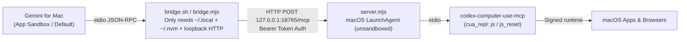

# Gemini for Mac & Antigravity CLI Computer Use MCP

English | [简体中文](./README_ZH.md)

One-command macOS setup to enable [`codex-computer-use-mcp`](https://github.com/tmustier/codex-computer-use-mcp) (`cua_repl`) for both **Gemini for Mac** (via a zero-dependency loopback HTTP-to-stdio MCP bridge for macOS App-Sandboxed apps) and **Antigravity CLI** (direct native stdio).

| Client | Transport | One-command setup |
|---|---|---|
| **Gemini for Mac** | Loopback HTTP gateway + lightweight stdio bridge | `bash scripts/install.sh` |
| **Antigravity CLI** | Direct native stdio (`~/.gemini/config/mcp_config.json`) | `bash scripts/install-antigravity.sh` |

---

## Why direct stdio fails in Gemini for Mac

Adding `codex-computer-use-mcp` directly as a **Local MCP (stdio)** server in Gemini for Mac fails during initialization with:

```text
EPERM: operation not permitted, lstat '/Applications'
```

`/Applications/Gemini.app` runs inside a strict **macOS App Sandbox** (`com.apple.security.app-sandbox`). Any stdio child process spawned by Gemini inherits that sandbox and cannot inspect `/Applications/ChatGPT.app` or launch the signed Computer Use components (`codex` / `node_repl` / `SkyComputerUseService`)—even if you grant Full Disk Access or Accessibility in System Settings.

---

## How it works

This bridge splits `codex-computer-use-mcp` into two zero-dependency Node.js 22+ layers:



- **Server (`src/server.mjs`)**: Runs as a user `LaunchAgent`, binds strictly to `127.0.0.1:18765`, requires a `0600` random Bearer token, exposes standard **MCP Streamable HTTP** (`POST /mcp`, `GET /mcp` SSE stream with keepalive, `DELETE /mcp`, `Mcp-Session-Id`), and hosts `codex-computer-use-mcp`.
- **Bridge (`src/bridge.mjs` / `bridge.sh`)**: A tiny stdio-to-Streamable-HTTP forwarder for Gemini for Mac (whose `Cloud MCP` tab only accepts remote HTTPS/OAuth URLs). It only reads `~/.local/share/cua-http-mcp/token` and talks to `127.0.0.1:18765/mcp`, which works out of the box with Gemini's **Default** sandbox setting (`~/.local`, `~/.nvm`, and outbound network are allowed by default). No app patching or sandbox disabling required.

---

## Prerequisites

1. **macOS** with an unlocked GUI user session
2. **Node.js >= 22**
3. Official **ChatGPT macOS app** opened at least once with its Computer Use component enabled (see [`codex-computer-use-mcp` requirements](https://github.com/tmustier/codex-computer-use-mcp#requirements))
4. macOS **Accessibility** and **Screen Recording** permissions granted as required by Computer Use

---

## Quick Start

```bash
git clone https://github.com/the-waste-land/gemini-mac-computer-use-bridge.git
cd gemini-mac-computer-use-bridge
```

### Option 1: Gemini for Mac

```bash
bash scripts/install.sh
```

The installer checks Node >= 22, installs (or reuses) `codex-computer-use-mcp`, generates a `0600` Bearer token, installs & loads `~/Library/LaunchAgents/com.local.cua-http-mcp.plist`, and runs an end-to-end self-test (`initialize` → `tools/list` → `computer_use_status`).

Then in **Gemini for Mac**:

1. Open **More → Customize → Connectors → Custom → Local MCP**
2. Fill in:
   - **Server Name**: `cua-bridge`
   - **Description**: `Local Computer Use MCP via loopback HTTP bridge`
   - **Command**: `/Users/<you>/.local/share/cua-http-mcp/bridge.sh` (printed by `install.sh`)
   - **Sandbox settings**: keep **`Default`**
3. Click **Next** → accept consent → **Connect**
4. Verify in a new chat:
   ```text
   @cua-bridge call computer_use_status and js (await cua.listApps()) to list my running macOS apps
   ```

> [!IMPORTANT]
> If you previously added `codex-computer-use-mcp` directly as a Local MCP (e.g. `computer-use`), **remove that old entry** in Gemini for Mac. A sandbox-blocked direct MCP entry can hang during initialization and cause Gemini's entire MCP tool discovery to time out (25s), blocking `@cua-bridge` as well.

> [!TIP]
> Override port or Node path if needed:
> `CUA_BRIDGE_PORT=18765 CUA_NODE_BIN=/path/to/node bash scripts/install.sh`

### Option 2: Antigravity CLI

```bash
bash scripts/install-antigravity.sh
```

Since Antigravity CLI runs in an unsandboxed terminal, it connects over native stdio directly. The script backs up and merges `computer-use` into `~/.gemini/config/mcp_config.json` and runs an end-to-end stdio self-test. Open a new Antigravity CLI session to use `js`, `js_reset`, and `computer_use_status`.

---

## Security Model

- The HTTP gateway binds **strictly to `127.0.0.1`** (never exposed to LAN or public networks).
- Every `/mcp` request requires `Authorization: Bearer <token>` stored at `~/.local/share/cua-http-mcp/token` (dir `700`, file `600`).
- Neither `/Applications/Gemini.app` nor macOS SIP/App Sandbox is modified.
- Computer Use grants direct UI control over your desktop and browsers—use only on your personal trusted Mac.

---

## Operations & Uninstall

```bash
# Check gateway health
curl -s http://127.0.0.1:18765/health

# View logs
tail -n 30 ~/.local/share/cua-http-mcp/server.log ~/.local/share/cua-http-mcp/server.err.log

# Restart background gateway
launchctl kickstart -k "gui/$(id -u)/com.local.cua-http-mcp"

# Clear lingering Computer Use software cursor if needed
pkill -f MacOS/SkyComputerUseService

# Uninstall
bash scripts/uninstall.sh                        # Gemini for Mac bridge + LaunchAgent
bash scripts/install-antigravity.sh --uninstall  # Antigravity CLI config entry
```

---

## Credits

- Built on top of [`tmustier/codex-computer-use-mcp`](https://github.com/tmustier/codex-computer-use-mcp).

## License

MIT
