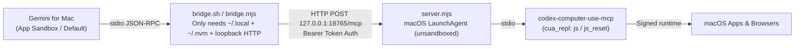

# Gemini for Mac Computer Use Bridge

English | [简体中文](./README.md)

A zero-dependency loopback HTTP-to-stdio MCP bridge that lets macOS App-Sandboxed MCP clients—such as **Gemini for Mac**—use [`codex-computer-use-mcp`](https://github.com/tmustier/codex-computer-use-mcp) (`cua_repl`) to control native macOS apps and browser tabs.

---

## Why is this needed?

Adding `codex-computer-use-mcp` directly as a **Local MCP (stdio)** server in Gemini for Mac fails with:

```text
EPERM: operation not permitted, lstat '/Applications'
```

`/Applications/Gemini.app` runs under **macOS App Sandbox** (`com.apple.security.app-sandbox`). Any stdio child process spawned by Gemini inherits that sandbox and cannot inspect `/Applications/ChatGPT.app` or launch the signed Computer Use components (`codex` / `node_repl` / `SkyComputerUseService`).

## Architecture



- **`src/server.mjs`** runs as a user `LaunchAgent`, binds strictly to `127.0.0.1:18765`, requires a `0600` random Bearer token, and hosts `codex-computer-use-mcp`.
- **`src/bridge.mjs` (`bridge.sh`)** is a tiny stdio JSON-RPC forwarder for Gemini for Mac. It only accesses `~/.local/share/cua-http-mcp` and loopback HTTP, which works out-of-the-box with Gemini's **Default** sandbox setting.

## Prerequisites

- **macOS** with an unlocked user session
- **Node.js >= 22**
- Official **ChatGPT macOS app** with its Computer Use component enabled (see [`codex-computer-use-mcp` requirements](https://github.com/tmustier/codex-computer-use-mcp#requirements))
- macOS Accessibility & Screen Recording permissions granted as required by Computer Use

## Quick Start

```bash
git clone https://github.com/the-waste-land/gemini-mac-computer-use-bridge.git
cd gemini-mac-computer-use-bridge
bash scripts/install.sh
```

Then in **Gemini for Mac**:

1. Open **More → Customize → Connectors → Custom → Local MCP**
2. Fill in:
   - **Server Name**: `cua-bridge`
   - **Command**: `/Users/<you>/.local/share/cua-http-mcp/bridge.sh` (printed by `install.sh`)
   - **Sandbox settings**: keep **`Default`**
3. Click **Next** → accept consent → **Connect**
4. Test in a new chat:
   ```text
   @cua-bridge call computer_use_status and js (await cua.listApps()) to list my running macOS apps
   ```

## Uninstall

```bash
bash scripts/uninstall.sh
```

## License

MIT
