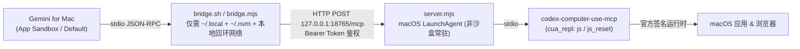

# Gemini for Mac & Antigravity CLI Computer Use MCP

[English](./README.md) | 简体中文

让 **Gemini for Mac**（受 macOS App Sandbox 限制）和 **Antigravity CLI**（非沙盒终端）都能一键接入 [`codex-computer-use-mcp`](https://github.com/tmustier/codex-computer-use-mcp)（`cua_repl`），实现操控 macOS 桌面应用和已登录浏览器标签页。

| 客户端 | 接入模式 | 一键命令 |
|---|---|---|
| **Gemini for Mac** | 本地回环 HTTP 网关 + 轻量 stdio 桥接（绕开 App Sandbox 对 `/Applications` 的限制） | `bash scripts/install.sh` |
| **Antigravity CLI** | 原生 stdio 直连（写入 `~/.gemini/config/mcp_config.json`） | `bash scripts/install-antigravity.sh` |

---

## 为什么直接配置会失败？

如果你直接把 `codex-computer-use-mcp` 作为 **Local MCP (stdio)** 填进 Gemini for Mac，通常会在初始化阶段遇到报错：

```text
EPERM: operation not permitted, lstat '/Applications'
```

原因是 `/Applications/Gemini.app` 开启了严格的 **macOS App Sandbox**（`com.apple.security.app-sandbox`），其拉起的 stdio 子进程会强制继承沙盒限制，无法访问 `/Applications/ChatGPT.app` 中的官方签名 Computer Use 运行时组件（`codex` / `node_repl` / `SkyComputerUseService`），哪怕在系统设置里给 Gemini 开了“完全磁盘访问权限”也无法解除。

---

## 工作原理

本项目将 `codex-computer-use-mcp` 拆分为两层，零第三方依赖（仅用 Node.js 22+ 内置模块）：



- **服务端（`server.mjs`）**：通过 `LaunchAgent` 在你的登录会话后台常驻，仅监听本机回环 `127.0.0.1:18765`，使用 `0600` 随机 Bearer Token 鉴权，提供标准 **MCP Streamable HTTP** 接口（`POST /mcp`、`GET /mcp` SSE 保活流、`DELETE /mcp`、`Mcp-Session-Id`），并托管 `codex-computer-use-mcp` 子进程。
- **桥接端（`bridge.sh`）**：提供给 Gemini for Mac 的轻量 stdio-to-Streamable-HTTP 桥接客户端（Gemini for Mac 的 `Cloud MCP` 仅支持公网 HTTPS/OAuth）。它只读取 `~/.local/share/cua-http-mcp/token` 并转发请求到 `127.0.0.1:18765/mcp`，完全契合 Gemini for Mac 的 **Default** Sandbox 规则（默认放行 `~/.local`、`~/.nvm` 和出站网络），不需要修改或关闭任何系统沙盒。

---

## 前置要求

1. **macOS**（已解锁的图形用户会话）
2. **Node.js >= 22**（如通过 `nvm` / Homebrew 安装）
3. 已安装并至少打开过一次官方 **ChatGPT macOS App**（且已启用其 Computer Use 组件；详见 [`codex-computer-use-mcp` 前置说明](https://github.com/tmustier/codex-computer-use-mcp#requirements)）
4. 已在 **系统设置 → 隐私与安全性** 中完成 macOS **辅助功能** 与 **屏幕录制** 授权

---

## 一键安装

```bash
git clone https://github.com/the-waste-land/gemini-mac-computer-use-bridge.git
cd gemini-mac-computer-use-bridge
bash scripts/install.sh
```

安装脚本会自动完成：
1. 检查 macOS 与 Node.js >= 22；
2. 复用已有或自动安装 `codex-computer-use-mcp` 到 `~/.local/share/cua-http-mcp/runtime`；
3. 生成本机随机 Bearer Token（权限 `600`）；
4. 安装并启动 `~/Library/LaunchAgents/com.local.cua-http-mcp.plist`（开机自启、异常自动拉起）；
5. 执行端到端自检（`initialize` → `tools/list` → `computer_use_status`），确认返回 `route: "cua_repl"` 与 `brokerVerified: true`。

> [!TIP]
> 如需自定义端口或 Node 路径，可通过环境变量覆盖：
> `CUA_BRIDGE_PORT=18765 CUA_NODE_BIN=/path/to/node bash scripts/install.sh`

---

## 在 Gemini for Mac 中配置

1. 打开 **Gemini for Mac**；
2. 左侧栏点击 **More → Customize → Connectors**；
3. 点击右上角 **Custom**，选择 **Local MCP**，填写：
   - **Server Name**：`cua-bridge`
   - **Description**：`Local Computer Use MCP via loopback HTTP bridge`
   - **Command**：`/Users/<你的用户名>/.local/share/cua-http-mcp/bridge.sh`（直接复制安装脚本最后打印的完整路径）
   - **Sandbox settings**：保持 **`Default`** 即可（默认包含 `~/.local`、`~/.nvm` 与出站网络权限）
4. 点击 **Next** → 勾选风险确认 → 点击 **Connect**。

> [!IMPORTANT]
> 如果你之前在 Gemini for Mac 中直接添加过 `codex-computer-use-mcp`（如旧的 `computer-use` Local MCP），**请务必将其删除**。残留的沙盒受阻直连配置会在握手时卡死，导致 Gemini 整个 MCP 工具列表拉取触发 25 秒超时，进而连带阻塞 `@cua-bridge`。

### 验证是否生效

在 Gemini for Mac 中新建对话，输入：

```text
@cua-bridge 请调用 computer_use_status 和 js (await cua.listApps()) 列出我当前打开的桌面应用
```

如果能正常返回你当前运行的 macOS 应用列表且无 `EPERM` 报错，即表示接入成功。

---

## Antigravity CLI 一键接入

非沙盒终端客户端（如 Antigravity CLI）可以直接走原生 stdio 接入，无需经过 HTTP 桥接：

```bash
bash scripts/install-antigravity.sh
```

脚本会自动检测 Node.js >= 22、安装或复用 `codex-computer-use-mcp`、备份并无损合并写入 `~/.gemini/config/mcp_config.json`，并运行 stdio MCP 握手与 `computer_use_status` 自检。完成后**新开一个 Antigravity CLI 会话**即可使用 `js` / `js_reset` / `computer_use_status`。

如需移除 Antigravity CLI 中的配置：

```bash
bash scripts/install-antigravity.sh --uninstall
```

手动配置参考（`~/.gemini/config/mcp_config.json`）：

```json
{
  "mcpServers": {
    "computer-use": {
      "command": "/path/to/node",
      "args": [
        "/Users/<你的用户名>/.local/share/cua-http-mcp/runtime/node_modules/codex-computer-use-mcp/dist/mcp-server.js"
      ]
    }
  }
}
```

---

## 安全性说明

- HTTP 网关**仅绑定 `127.0.0.1`**，不对外网或局域网暴露。
- 所有 `/mcp` 请求均强制校验 `Authorization: Bearer <token>`，Token 存于 `~/.local/share/cua-http-mcp/token`（目录 `700`，文件 `600`）。
- 未修改 `/Applications/Gemini.app`，未关闭 macOS SIP 或 App Sandbox。
- Computer Use 具备直接操控屏幕与应用的高权限，仅限个人可信本机使用。

---

## 常用运维与卸载

```bash
# 查看网关健康状态
curl -s http://127.0.0.1:18765/health

# 查看运行日志
tail -n 30 ~/.local/share/cua-http-mcp/server.log ~/.local/share/cua-http-mcp/server.err.log

# 重启后台服务
launchctl kickstart -k "gui/$(id -u)/com.local.cua-http-mcp"

# 如果屏幕上残留 Computer Use 虚拟光标，立即清理
pkill -f MacOS/SkyComputerUseService

# 完全卸载
bash scripts/uninstall.sh
```

---

## 致谢

- 底层 Computer Use MCP 适配由 [`tmustier/codex-computer-use-mcp`](https://github.com/tmustier/codex-computer-use-mcp) 提供。
